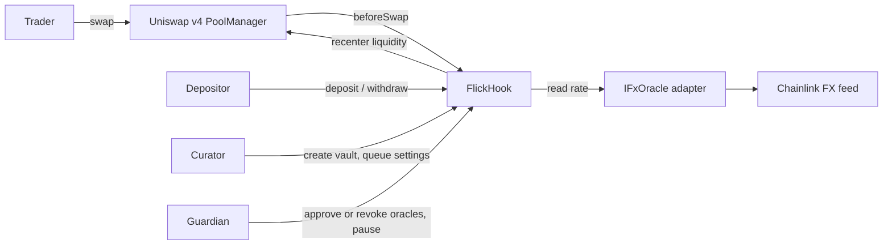
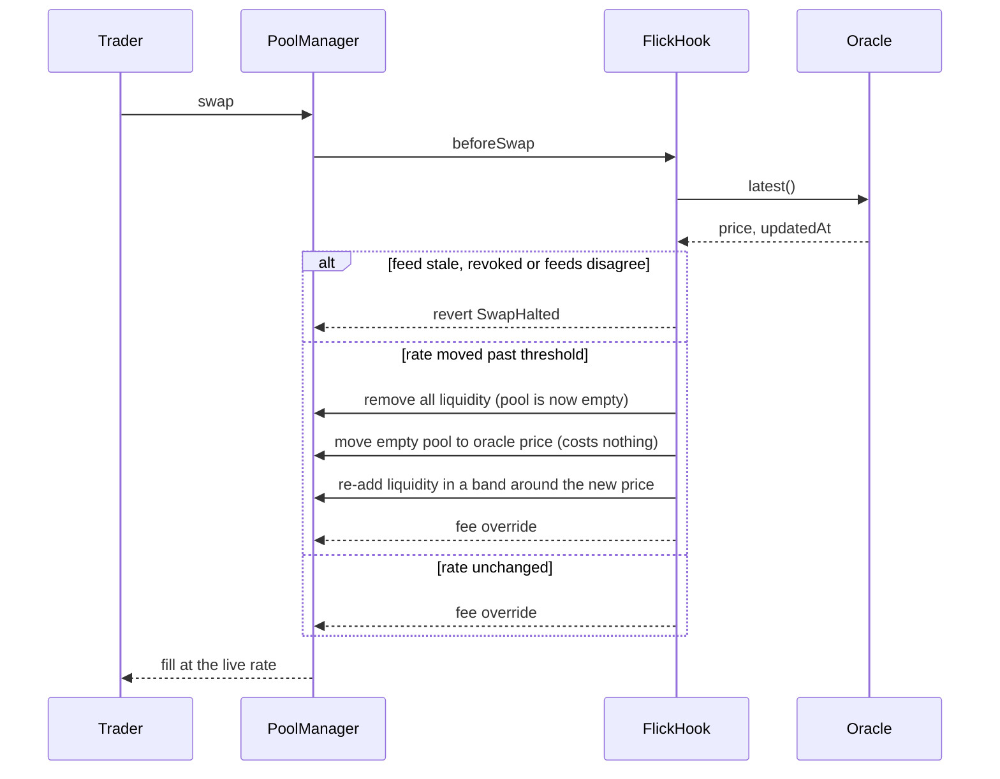

# Flick

**FX liquidity that never trades at a stale price.**

*A Uniswap v4 hook that moves a vault's liquidity to the live exchange rate before every swap, so liquidity providers stop paying for out-of-date prices.*

- **Live on Base Sepolia:** hook and oracle verified on BaseScan, vault seeded, real swaps executed ([see the transactions](#live-on-base-sepolia))
- **Built for:** Uniswap Hook Incubator, cohort 11 (UHI11) Hookathon
- **Theme:** Active Management and Curated Liquidity
- **Headline result:** in the same 1% euro move, an arbitrageur takes **1,859.59 USDC** from a plain v4 pool's LP, and **loses 138.04 USDC** to Flick's LP
- **Tests:** 144 (unit, fuzz, oracle, integration and security regressions)
- **Run it:** `forge install && forge test` ([details](#run-it))

> Status: prototype. Not audited. Do not use with real funds.

---

## The result

Same liquidity, same band, same 1% move in the euro, same 200,000 USDC arbitrage trade:

| | Arbitrageur | Liquidity provider |
|---|---|---|
| Plain Uniswap v4 pool | **gains** 1,859.59 USDC | **loses** 1,859.59 USDC |
| Flick vault | **loses** 138.04 USDC | **gains** 138.04 USDC |

The loss doesn't just shrink, it changes sign. The trade that drains a plain pool is a losing trade against Flick, and the LP earns the fee.

Reproduce it in one command:

```bash
forge test --match-test test_Arbitrage_PlainPoolLoses_FlickDoesNot -vv
```

### What to look at (for reviewers)

1. **The headline test:** `test_Arbitrage_PlainPoolLoses_FlickDoesNot` in [`test/integration/FlickRecenter.t.sol`](test/integration/FlickRecenter.t.sol)
2. **The core logic:** `_beforeSwap` (16 lines) and `_recenter` in [`src/FlickHook.sol`](src/FlickHook.sol) (lines 467 and 493)
3. **Why the recenter is free:** `_beforeAddLiquidity` (line 458), which makes the vault the pool's only LP
4. **The safety stop:** [`test/integration/FlickSecurity.t.sol`](test/integration/FlickSecurity.t.sol), one test per fix from internal review
5. **A real swap on-chain:** [the Base Sepolia swap transaction](https://sepolia.basescan.org/tx/0xe541bee1002d7a653a3a82661acb0887283349e2a7edeb17c66fbe39f3629dc3)

---

## Why

Stablecoin pairs like EURC/USDC are not pegged to each other. They follow the EUR/USD exchange rate, which moves all day.

An AMM pool only changes price when someone trades. When the real rate moves, the pool is briefly wrong, and the first trader to notice buys the cheap side. That profit comes straight out of the liquidity providers' pockets. This is loss-versus-rebalancing (LVR), and it is the main reason on-chain FX liquidity is thin: providing it loses money to faster traders.

Fixed-peg stable pool designs don't help, because there is no fixed peg to hold.

**Think of a currency exchange booth.** Every morning the owner writes the day's rate on the board. If the real rate moves at noon and the board isn't updated, anyone can buy euros at the old rate and sell them elsewhere, and the booth pays. Flick is a booth that checks the live rate before every customer and rewrites the board first.

**Beyond EURC.** The same design fits any non-USD stablecoin pair: GBP, JPY, BRL, NGN and more. Where a currency has a gap between its official and market rates, Flick's two-feed divergence check stops trading the moment the two disagree.

---

## How it works



### What happens inside one swap



**Why the recenter costs nothing.** `beforeAddLiquidity` only lets the vault provide liquidity, so the vault is the pool's sole LP. Once it removes its position the pool is empty, and an empty pool's price can be moved without trading against anyone.

### Why this needs a v4 hook

| Requirement | What makes it possible |
|---|---|
| Act **before** the swap, in the same transaction | `beforeSwap` |
| Move price without paying for it | Exclusive liquidity via `beforeAddLiquidity`, so the pool can be emptied |
| No pool ever starts at a wrong price | `beforeInitialize`: pools only open through `createVault`, at the oracle rate |
| Fee set per vault by its curator | Dynamic fee flag with a fee override from `beforeSwap` |

A v3 pool or an off-chain keeper can't do this: a keeper's rebalance lands in a separate transaction that the arbitrageur can front-run, and anyone else's liquidity in the pool would make moving the price expensive.

### Oracle states

| State | When | Recenter | Swaps | Fee |
|---|---|---|---|---|
| Normal | Feed is fresh and approved, and agrees with the second feed if there is one | Yes | Open | Vault fee |
| Halted | Any feed too old, revoked or reading zero, or the two feeds disagree | No | Closed | None |

Withdrawals read no price feed and work in every state, including when a vault is paused.

### Roles

| Role | Can | Cannot |
|---|---|---|
| Guardian | Approve price feed adapters, revoke one (halting every vault that uses it), pause a vault's swaps and deposits, hand the role over in two steps | Move funds, block withdrawals |
| Curator | Create a vault, queue new settings (24-hour delay), claim a share of swap fees | Move depositor funds, exceed protocol limits, skip the delay, switch to a feed for a different currency |
| Depositor | Deposit, withdraw | |
| Anyone | Swap, trigger a recenter when one is due, apply queued settings after the delay | |

### Protocol limits

| Setting | Limit |
|---|---|
| Band half width | 20% |
| Swap fee | 1% |
| Curator share of swap fees | 20% |
| Staleness window | 7 days |
| Delay before new settings apply | 24 hours |
| Price gap allowed when switching primary feed | 5% from the vault's current rate |

### Shares

- The curator's seed is the first deposit. One share starts out worth one quote token.
- Deposits mint an exact number of shares and pay both tokens in the vault's current ratio. No price is used, so a deposit can't be used to trade against a stale feed.
- Withdrawals return the same fraction of everything the vault holds.
- Swap fees are collected into the vault before any shares are minted or burned.
- A small amount of shares is locked at creation so the share supply never returns to zero.

---

## Live on Base Sepolia

| Contract | Address |
|---|---|
| FlickHook (verified) | [`0xD5cf8eF4fCFD019aD9eA7b6a62c956D9C26Ea880`](https://sepolia.basescan.org/address/0xD5cf8eF4fCFD019aD9eA7b6a62c956D9C26Ea880) |
| MockFxOracle, EUR / USD (verified) | [`0x224a966f4Bc0F66d9A501e0e6dD64158DdF19bC2`](https://sepolia.basescan.org/address/0x224a966f4Bc0F66d9A501e0e6dD64158DdF19bC2) |
| EURC/USDC pool id | `0xfd46c9a0224ea1181b39243aae91d60d6da823d0469502131e155edbf0ab2f67` |
| Uniswap v4 PoolManager | [`0x05E73354cFDd6745C338b50BcFDfA3Aa6fA03408`](https://sepolia.basescan.org/address/0x05E73354cFDd6745C338b50BcFDfA3Aa6fA03408) |
| EURC | [`0x808456652fdb597867f38412077A9182bf77359F`](https://sepolia.basescan.org/address/0x808456652fdb597867f38412077A9182bf77359F) |
| USDC | [`0x036CbD53842c5426634e7929541eC2318f3dCF7e`](https://sepolia.basescan.org/address/0x036CbD53842c5426634e7929541eC2318f3dCF7e) |

### On-chain proof

| Step | Transaction |
|---|---|
| Deploy hook | [`0x41c38375…`](https://sepolia.basescan.org/tx/0x41c38375a7aa58175ca68bbfc6e2575359a48dc397794f22aa5ae042eab08543) |
| Create and seed the vault (10 EURC + 10 USDC at 1.15) | [`0x6405bdd2…`](https://sepolia.basescan.org/tx/0x6405bdd29b77a13213f4e42ed6ae31c4def94b0a5a7edac26c020b42feb327c6) |
| Swap 1 USDC through the hook | [`0xe541bee1…`](https://sepolia.basescan.org/tx/0xe541bee1002d7a653a3a82661acb0887283349e2a7edeb17c66fbe39f3629dc3) |

The test swap sold 1 USDC and received 0.868880 EURC. At the oracle rate of 1.15, 1 USDC is 0.869565 EURC; after the 0.05% fee that is 0.869130. The remaining ~0.03% is slippage in a deliberately tiny 20-token test vault. Oracle status stayed Normal, and the vault's centre stayed at 1.15 because the rate didn't move.

Gas on Base Sepolia: about 170,000 for a swap through the hook, and about 600,000 to create and seed a vault.

---

## Evaluation

### What a late feed can cost

A push feed such as Chainlink only updates when the rate moves past its deviation threshold. In that window, a trader who sees the real rate move can trade before the update lands. A trader only acts while the gap is bigger than the swap fee, so the fee caps the loss. Figures for a 2,000,000 USDC vault with a 0.5% band:

| Gap between feed and real rate | 0.01% fee | 0.05% fee |
|---|---|---|
| 0.05% | LP loses 16 USDC | Not worth trading. LP loses 0 |
| 0.10% (Chainlink's EUR/USD threshold) | LP loses 81 USDC | LP loses 25 USDC |

For comparison, a plain pool has no cap. The gap keeps growing until someone trades, and a 1% move cost a plain-pool LP 1,859.59 USDC in the headline test.

The swap fee is a curator setting: a lower fee attracts more volume, a higher fee prices out more of the gap. The create script defaults to 0.05%.

### Test coverage

| Suite | Tests | Covers |
|---|---|---|
| `unit/FxMath.t.sol` | 19 | Oracle price to Uniswap price conversions, including fuzzing |
| `unit/BandMath.t.sol` | 13 | Band edges and the recenter trigger |
| `oracles/` | 19 | Chainlink adapter (staleness, sequencer downtime, decimals) and the mock |
| `integration/FlickHook.t.sol` | 28 | Vault creation, the swap check, oracle states, guardian handover |
| `integration/FlickVault.t.sol` | 26 | Deposits, withdrawals, share accounting, fees, solvency |
| `integration/FlickRecenter.t.sol` | 31 | Recentering, curator settings, pause, plain pool vs Flick |
| `integration/FlickSecurity.t.sol` | 8 | One regression test per internal-review finding |
| **Total** | **144** | |

---

## Limitations

- **Push-oracle latency.** Between Chainlink updates, a trader with a faster view of the rate can still act. The loss is capped by the fee (table above). A pull oracle updated in the same transaction as the swap would remove it.
- **The guardian decides which feeds are trusted.** On mainnet it should be a multisig, and it must never approve a feed whose owner can set the price, such as `MockFxOracle`.
- **Open vault creation.** Anyone can create a vault for any pair, and the first creator of a pool key becomes its curator. Interfaces should list only trusted vaults. Review found no way for one vault to reach another's funds.
- **Shares are internal balances**, not transferable tokens, and the curator role can't be transferred yet.
- **Unsupported tokens:** fee-on-transfer, rebasing and native tokens.
- **Not audited.** Internal review only.

### Protections in place

- Swaps stop whenever the price can't be trusted. Withdrawals always work.
- A curator can't switch to a feed more than 5% from the vault's current rate, and every settings change waits 24 hours.
- The guardian can halt and pause but can't move funds, and the role can be handed to a multisig in two steps.
- On rollups, the Chainlink adapter treats the price as stale while the sequencer is down and for an hour after it restarts.
- `deposit` and `withdraw` take slippage limits and a deadline.

---

## Run it

Requires [Foundry](https://book.getfoundry.sh/getting-started/installation).

```bash
git clone https://github.com/pheobeayo/flick
cd flick
forge install
forge build      # uses via_ir, so the first build takes a few minutes
forge test       # all 144 tests
```

### Deploy your own

The scripts sign with a Foundry keystore, never a key in a file.

```bash
cast wallet import flick --interactive

export RPC=https://sepolia.base.org
export ME=<your wallet address>
export ETHERSCAN_API_KEY=<key from etherscan.io, works for BaseScan>
export BASE_TOKEN=0x808456652fdb597867f38412077A9182bf77359F   # EURC
export QUOTE_TOKEN=0x036CbD53842c5426634e7929541eC2318f3dCF7e  # USDC

# 1. Deploy the hook (mines a valid hook address first)
GUARDIAN=$ME forge script script/00_DeployHook.s.sol \
  --rpc-url $RPC --account flick --sender $ME --broadcast \
  --verify --etherscan-api-key $ETHERSCAN_API_KEY

# 2. Create and seed a vault with a mock EUR/USD feed at 1.15
HOOK=<hook address> SEED_BASE=10000000 SEED_QUOTE=10000000 \
MOCK_PRICE=1150000000000000000 \
forge script script/01_CreateVault.s.sol \
  --rpc-url $RPC --account flick --sender $ME --broadcast \
  --verify --etherscan-api-key $ETHERSCAN_API_KEY

# 3. Swap 1 USDC for EURC and print what the hook did
HOOK=<hook address> AMOUNT_IN=1000000 SELL_BASE=false \
forge script script/02_Swap.s.sol \
  --rpc-url $RPC --account flick --sender $ME --broadcast
```

Price source options for step 2 (pick one):

| Variable | Meaning |
|---|---|
| `CHAINLINK_FEED` | A Chainlink feed address. The script wraps and approves it. On Base mainnet, also set `SEQUENCER_FEED`. |
| `MOCK_PRICE` | An 18-decimal price. The script deploys a mock feed you control. |
| `ORACLE` | An adapter the guardian has already approved. |

A mock feed must be refreshed at least every 25 hours, or swaps stop:

```bash
cast send <oracle address> "setPrice(uint256)" 1150000000000000000 --rpc-url $RPC --account flick
```

[`GUIDE.md`](GUIDE.md) has the full walkthrough: a codebase tour, units cheat sheet, verification, and every action through `cast` or BaseScan.

### Repository layout

```
src/
  FlickHook.sol                   Hook, vaults, shares, recentering, fees
  interfaces/IFxOracle.sol        Interface every price source implements
  libraries/FxMath.sol            Oracle price <-> Uniswap price conversions
  libraries/BandMath.sol          Liquidity band and recenter trigger
  oracles/ChainlinkFxOracle.sol   Adapter for Chainlink FX feeds
  oracles/MockFxOracle.sol        Hand-set price for tests and demos
  types/FlickTypes.sol            Shared structs and enums
script/
  base/BaseScript.sol             Finds Uniswap v4 on the current chain
  00_DeployHook.s.sol             Deploy the hook
  01_CreateVault.s.sol            Set up a price source, create and seed a vault
  02_Swap.s.sol                   Swap through a vault and print what the hook did
test/
  unit/                           Maths libraries
  oracles/                        Oracle adapters
  integration/                    Hook, vault, recenter and security regressions
  utils/                          Shared test setup
GUIDE.md                          Team guide: codebase tour, deploy, verify, test
```

---

## Roadmap

- **Pull oracle adapter (Pyth)** updated in the same transaction as the swap, closing the push-feed latency window. This needs an update path added to the read-only oracle interface.
- **Transferable vault shares** as an ERC-20, so LP positions compose with the rest of DeFi.
- **Multisig guardian** and a transferable curator role.
- **More pairs**, starting with currencies that have a gap between official and market rates, where the two-feed divergence check matters most.
- **Professional audit** before any mainnet deployment.

## Built with

Uniswap v4 core and periphery, OpenZeppelin uniswap-hooks, Chainlink, Foundry, Base.

## License

MIT