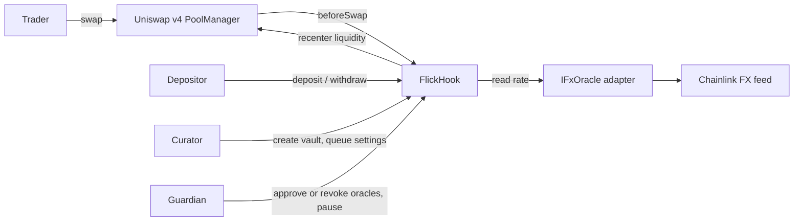

# Flick

Curated FX liquidity vaults for non-USD stablecoins, built as a Uniswap v4 hook.

Flick keeps a pool's liquidity centred on the real exchange rate. Before every swap, the hook checks an FX price feed. If the rate has moved, it moves the vault's liquidity to the new rate first, and only then lets the swap trade. Liquidity providers stop paying for stale prices.

Built for the Uniswap Hook Incubator, cohort 11 (UHI11). Theme: Active Management and Curated Liquidity.

> Status: prototype. Not audited. Do not use with real funds.

## The problem

Stablecoin pairs like EURC/USDC are not pegged to each other. They follow the EUR/USD exchange rate, which moves all day.

An AMM pool only changes price when someone trades. When the real rate moves, the pool is briefly wrong, and the first trader to notice buys the cheap side. That profit comes straight out of the liquidity providers' pockets. It is the main reason on-chain FX liquidity is thin: providing it loses money to faster traders.

Fixed-peg stable pool designs do not help here, because there is no fixed peg to hold.

## In one paragraph

Think of a currency exchange booth. Every morning the owner writes the day's EUR/USD rate on the board. If the real rate moves at noon and the board is not updated, anyone can walk up, buy euros at the old rate, and sell them elsewhere for a profit, paid for by the booth. Flick is a booth that checks the live rate before every single customer and rewrites the board first. Customers always trade at the current rate, so nobody can profit from an out-of-date one, and the people who fund the booth keep their money.

## How Flick works

1. A curator creates a vault for a pair, picks an approved price feed, and seeds it.
2. Depositors add both tokens and receive shares of the vault.
3. The vault holds one concentrated liquidity position in a narrow band around the feed's rate.
4. Before every swap the hook reads the feed:
   - Rate unchanged: the swap goes through at the vault's fee.
   - Rate moved: the hook removes the position, moves the empty pool to the new rate at no cost, puts the position back around the new rate, then lets the swap through.
   - Feed late, revoked, or two feeds disagree: swaps stop until the feed is healthy again. The vault never trades at a price it cannot trust.
5. Depositors can withdraw at any time. Withdrawals read no price feed and cannot be paused.

The recenter costs the vault nothing because the vault is the pool's only liquidity provider. Once its position is removed the pool is empty, and an empty pool's price can be moved without trading against anyone.

## Result

Same liquidity, same band, same 1% move in the euro, same 200,000 USDC arbitrage trade (`test_Arbitrage_PlainPoolLoses_FlickDoesNot`):

| | Arbitrageur | Liquidity provider |
|---|---|---|
| Plain v4 pool | gains 1,859.59 USDC | loses 1,859.59 USDC |
| Flick vault | loses 138.04 USDC | gains 138.04 USDC |

Run it yourself:

```bash
forge test --match-test test_Arbitrage_PlainPoolLoses_FlickDoesNot -vv
```

## Architecture



One contract, `FlickHook`, is the hook, the vault and the share ledger. It manages many vaults, one per pool.

### Hook permissions

| Callback | Why |
|---|---|
| `beforeInitialize` | Pools can only be created through `createVault`, so none starts at a wrong price. |
| `beforeAddLiquidity` | Only the vault may provide liquidity. This is what makes a free recenter possible. |
| `beforeSwap` | Reads the feed, recenters if needed, and sets the swap fee. |

### Roles

| Role | Can | Cannot |
|---|---|---|
| Guardian | Approve price feed adapters, revoke one (halting every vault that uses it), pause a vault's swaps and deposits, hand the role to a new address in two steps | Move funds, block withdrawals |
| Curator | Create a vault, queue new settings (24 hour delay), claim a share of swap fees | Move depositor funds, exceed protocol limits, skip the delay, switch to a feed for a different currency |
| Depositor | Deposit, withdraw | |
| Anyone | Swap, trigger a recenter when one is due, apply queued settings after the delay | |

### Oracle states

| State | When | Recenter | Swaps | Fee |
|---|---|---|---|---|
| Normal | Feed is fresh and approved, and agrees with the second feed if there is one | Yes | Open | Vault fee |
| Halted | Any feed too old, revoked or reading zero, or the two feeds disagree | No | Closed | None (no swaps) |

### Protocol limits

Curator settings must stay inside these fixed bounds:

| Setting | Limit |
|---|---|
| Band half width | 20% |
| Swap fee | 1% |
| Curator share of swap fees | 20% |
| Staleness window | 7 days |
| Delay before new settings apply | 24 hours |
| Price gap allowed when switching primary feed | 5% from the vault's current rate |

### Shares

- The curator's seed is the first deposit. One share starts out worth one quote token.
- Deposits mint an exact number of shares and pay both tokens in the vault's current ratio. No price is used, so a deposit cannot be used to trade against a stale feed.
- Withdrawals return the same fraction of everything the vault holds.
- Swap fees are collected into the vault before any shares are minted or burned.
- A small amount of shares is locked at creation so the share supply never returns to zero.

## User flows

**Curator** (sets up and runs a vault)
1. Asks the guardian to approve a price feed for the pair.
2. Calls `createVault` with the pool, the feed, the settings and a seed of both tokens. The pool opens at the feed's rate with the seed as its liquidity.
3. Later, can queue new settings. They apply after 24 hours, which gives depositors time to leave if they disagree.
4. Claims their cut of swap fees with `claimCuratorFees`.

**Depositor** (provides liquidity)
1. Picks a vault and calls `previewDeposit` to see how much of each token a number of shares costs.
2. Calls `deposit` with a maximum for each token and a deadline. Pays both tokens in the vault's current mix and receives shares.
3. Earns a share of swap fees while the vault keeps their liquidity at the live rate.
4. Calls `withdraw` at any time, even when swaps are halted, with a minimum for each token and a deadline, and receives the same fraction of everything the vault holds.

**Trader** (swaps)
1. Swaps through any Uniswap v4 router as with any pool.
2. Before the trade, the hook checks the feed. If the rate moved, the vault's liquidity moves to the new rate first.
3. The trade fills at the live rate and pays the vault's fee.

**Guardian** (safety role)
1. Approves price feeds that curators may use.
2. Revokes a feed that misbehaves. Every vault priced by it stops swapping at once.
3. Pauses a single vault in an emergency. Withdrawals keep working.
4. Hands the role to a multisig with `transferGuardian`, which the multisig confirms with `acceptGuardian`.

## Repository layout

```
src/
  FlickHook.sol               Hook, vaults, shares, recentering, fees
  interfaces/IFxOracle.sol    Interface every price source implements
  libraries/FxMath.sol        Oracle price <-> Uniswap price conversions
  libraries/BandMath.sol      Liquidity band and recenter trigger
  oracles/ChainlinkFxOracle.sol   Adapter for Chainlink FX feeds
  oracles/MockFxOracle.sol        Hand-set price for tests and demos
  types/FlickTypes.sol        Shared structs and enums
script/
  base/BaseScript.sol         Finds Uniswap v4 on the current chain
  00_DeployHook.s.sol         Deploy the hook
  01_CreateVault.s.sol        Set up a price source, create and seed a vault
  02_Swap.s.sol               Swap through a vault and print what the hook did
test/
  unit/                       Maths libraries
  oracles/                    Oracle adapters
  integration/                Hook, vault, recenter and security regressions
  utils/                      Shared test setup
GUIDE.md                      Team guide: codebase tour, deploy, verify, test
```

## Getting started

Requires [Foundry](https://book.getfoundry.sh/getting-started/installation).

```bash
git clone <repo url>
cd flick
forge install
forge build
forge test
```

The build uses `via_ir` and takes a few minutes the first time.

## Tests

144 tests, including fuzz tests on the maths, the oracle adapter, recentering and vault solvency.

```bash
forge test                                   # everything
forge test --match-path test/integration/*   # hook behaviour
forge test --match-test test_Arbitrage -vv   # the headline comparison
```

## Deploying

[GUIDE.md](GUIDE.md) has the full walkthrough: setup, manual verification, and testing every function with cast or on BaseScan.

The scripts read the signing key from a Foundry keystore, never from a file in the repo.

```bash
cast wallet import flick --interactive

export RPC=https://sepolia.base.org
export ME=<your wallet address>
export ETHERSCAN_API_KEY=<key from etherscan.io, works for BaseScan>

# 1. Deploy the hook
GUARDIAN=$ME forge script script/00_DeployHook.s.sol \
  --rpc-url $RPC --account flick --sender $ME --broadcast \
  --verify --etherscan-api-key $ETHERSCAN_API_KEY

# 2. Create and seed a vault
HOOK=<hook address> \
BASE_TOKEN=<EURC address> \
QUOTE_TOKEN=<USDC address> \
SEED_BASE=10000000 SEED_QUOTE=10000000 \
MOCK_PRICE=1150000000000000000 \
forge script script/01_CreateVault.s.sol \
  --rpc-url $RPC --account flick --sender $ME --broadcast \
  --verify --etherscan-api-key $ETHERSCAN_API_KEY
```

Price source options for step 2, pick one:

| Variable | Meaning |
|---|---|
| `CHAINLINK_FEED` | Address of a Chainlink feed. The script wraps and approves it. On Base mainnet, also set `SEQUENCER_FEED` to Chainlink's sequencer uptime feed. |
| `MOCK_PRICE` | An 18 decimal price. The script deploys a mock feed you control. |
| `ORACLE` | An adapter the guardian has already approved. |

```bash
# 3. Swap 1 USDC for EURC and see what the hook did
HOOK=<hook address> BASE_TOKEN=<EURC address> QUOTE_TOKEN=<USDC address> \
AMOUNT_IN=1000000 SELL_BASE=false \
forge script script/02_Swap.s.sol \
  --rpc-url $RPC --account flick --sender $ME --broadcast
```

A mock feed must be refreshed at least every 25 hours, or swaps stop until it is:

```bash
cast send <oracle address> "setPrice(uint256)" 1150000000000000000 --rpc-url $RPC --account flick
```

### Deployments

| Network | Contract | Address |
|---|---|---|
| Base Sepolia | FlickHook | to be added |
| Base Sepolia | EURC/USDC vault oracle | to be added |

## Security

This is hackathon code. It has had an internal review and has not been professionally audited.

Protections in place:

- Swaps stop whenever the price cannot be trusted: a feed too old, revoked or reading zero, or two feeds that disagree. Withdrawals always work.
- A curator cannot switch the vault to a feed more than 5% away from its current rate, and every settings change waits 24 hours.
- The guardian can halt and pause but cannot move funds, and the role can be handed to a multisig in two steps.
- On rollups, the Chainlink adapter treats the price as stale while the sequencer is down and for an hour after it restarts.
- `deposit` and `withdraw` take slippage limits and a deadline.

Known limitations:

- A push feed such as Chainlink only updates when the rate moves past its deviation threshold (0.1% on Chainlink's EUR/USD feeds; check the exact figure for your chain at data.chain.link). Someone who sees the real rate move can trade before the update lands. The loss is capped and mostly priced out by the swap fee (see below). A pull oracle updated in the same transaction as the swap would remove it.
- The guardian decides which feeds are trusted. On mainnet it should be a multisig, and it must never approve a feed whose owner can set the price, such as `MockFxOracle`.
- Anyone can create a vault for any token pair, and the first creator of a pool key becomes its curator. Interfaces should list only trusted vaults. The review found no way for one vault to reach another's funds.
- Shares are internal balances, not transferable tokens. The curator role cannot be transferred.
- Fee-on-transfer, rebasing and native tokens are not supported.

### What a late feed can cost

The worst case for an LP is a trader acting on the full gap between the feed and the real rate. A trader only trades while the gap is bigger than the swap fee, so the fee decides how much of the gap they can take. Figures for a 2,000,000 USDC vault with a 0.5% band:

| Gap between feed and real rate | 0.01% fee | 0.05% fee |
|---|---|---|
| 0.05% | LP loses 16 USDC | Not worth trading. LP loses 0 |
| 0.10% (Chainlink's maximum) | LP loses 81 USDC | LP loses 25 USDC |

For comparison, a plain pool has no cap. The gap keeps growing until someone trades, and a 1% move cost a plain pool LP 1,859.59 USDC in the test above.

The swap fee is a curator setting. A low fee attracts more volume; a higher fee prices out more of the gap. The create script defaults to 0.05%.

## Roadmap

- Low-latency pull oracle adapter (Pyth). The current interface is read-only, so this needs an update path added to the hook
- Transferable vault shares
- Multisig guardian and transferable curator role
- More pairs, including currencies with a gap between official and market rates, where the two-feed divergence check matters most
- Professional audit

## Built with

Uniswap v4 core and periphery, OpenZeppelin uniswap-hooks, Foundry.

## License

MIT